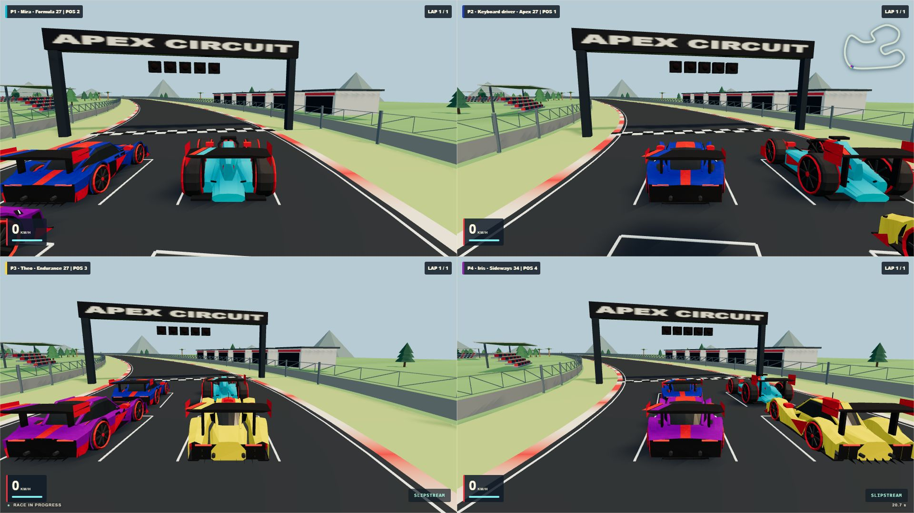
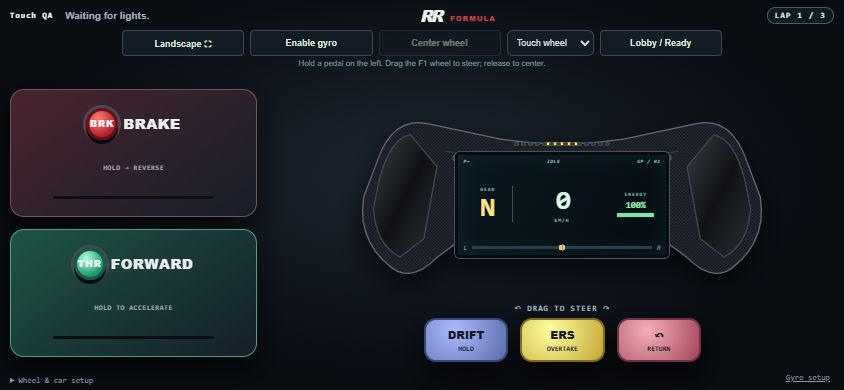
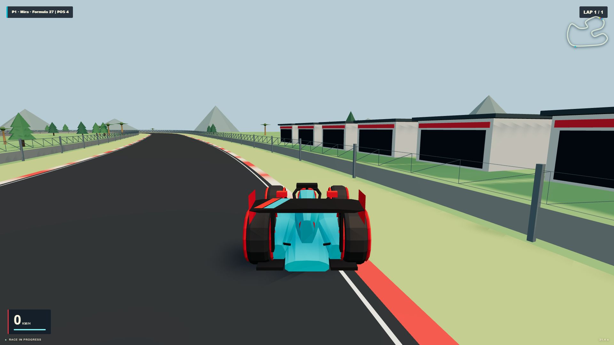
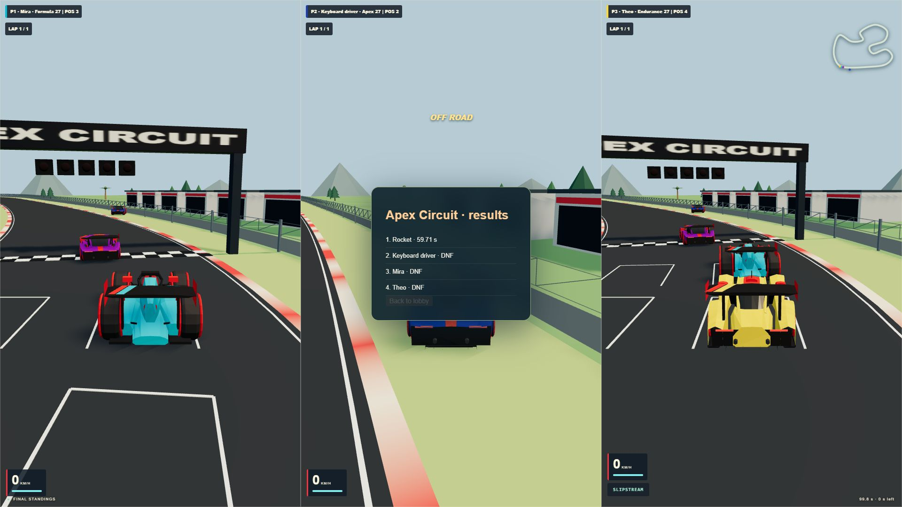

# Room Rally GP

**A local multiplayer 3D racing game. One shared screen, up to four drivers, and your phone as the controller.**

Connect over the same Wi-Fi, scan the lobby QR code, choose a car, and race. Room Rally GP runs on your computer with a Node.js server and a browser-based Three.js renderer. Phones send controls over WebSockets—no controller app or account required.



## Features

- **1–4 local players** with automatic split-screen: full screen, two horizontal halves, three vertical columns, or four quarters.
- **Phone touch steering:** brake and forward on the left, a draggable Formula-style wheel on the right, and Drift, ERS, and Return below it. Release the wheel to center steering.
- **Optional gyro steering**, plus keyboard and standard browser gamepad support.
- **Eight low-poly cars**, each with its own handling, and **16 body paint choices**.
- **25 circuits** with track previews, checkpoints, lap timing, kerbs, barriers, and pit buildings.
- **Circuit Race, Time Trial, and Drift Challenge** modes.
- **Driver-controlled ERS**, braking regeneration, drifting, collisions, and AI opponents in Circuit Race.
- **Personal phone audio** with your own engine, nearby rivals, stereo positioning, Doppler, tires, and impact sounds. Stock 42 uses recorded engine loops from the included Vehicle SFX Free assets.
- **LAN play without cloud services:** after dependencies are installed, the game runs locally.

## Screenshots

### Phone controller

The full wheel area accepts touch steering. Hold a pedal with one thumb and turn the wheel with the other.



### Single-player view



### Three-player split screen



These are screenshots of the app, not concept renders.

## Quick start

### Requirements

- **Node.js 22 or newer** and npm.
- A computer browser with **WebGL 2** and hardware acceleration enabled.
- Phones and the game computer connected to the **same local network**.

From the project folder:

```sh
npm install
npm start
```

1. Open **http://localhost:3000/** on the game computer, or use the Host link printed in the terminal.
2. Scan the lobby QR code on each phone. Touch steering is the default; gyro requires the HTTPS setup below.
3. Enter a driver name and choose a car. The first joined driver becomes **HOST**.
4. Open **Lobby / Ready** to choose paint and mark yourself ready. The HOST chooses the track, mode, and laps.
5. Once everyone is ready, the HOST starts the race.

Keep the server terminal running. Up to four drivers can join; opening the shared display alone does not add a racer. To race from the computer, choose **Drive on this computer**. For a gamepad, press **A** to join.

The shared display uses HTTP port **3000**. Secure phone controllers use HTTPS port **3443**, sharing the same room. Starting from the display requests fullscreen; for a phone-started race, use the display's fullscreen button first if you want native fullscreen.

## Controls

| Action | Phone | Keyboard | Standard gamepad |
| --- | --- | --- | --- |
| Steer | Drag the touch wheel, or select gyro and turn the phone | A / D or Left / Right | Left stick |
| Accelerate | Hold FORWARD | W / Up | RT |
| Brake, then reverse | Hold BRAKE | S / Down | LT |
| Drift | Hold DRIFT; optional tap-to-toggle in setup | Shift | B |
| ERS / overtake | Hold ERS while accelerating | B or Space | X |
| Return car to track | RETURN | R | Y |

Brake takes priority if both pedals are held. Drifting changes grip; it does not award a power-up. ERS consumes stored energy and regenerates faster under braking.

In the gamepad lobby, **A** toggles readiness, **LB/RB** changes car, and **D-pad left/right** changes paint. The HOST can use **Y** for track, **X** for mode, **D-pad up/down** for laps, and **Start** to race. **Back/Select** leaves the room. Button labels assume a standard Xbox-style mapping.

Phone controls use a landscape layout. If the browser stays in portrait, the controller rotates sideways automatically. **Landscape ⛶** requests fullscreen and native orientation locking where supported. Open **Lobby / Ready** or **Wheel & car setup** for settings; **Back to controller** returns to driving.

## Optional gyro setup

Touch steering works without motion permissions. Browser gyro access requires **trusted HTTPS** on the phone.

1. Open **Gyro HTTPS setup** beside the display QR code, then open that setup link on your phone.
2. Compare the certificate fingerprint with the one shown on the computer.
3. Download and install the **Room Rally Local Game CA** public certificate using the setup page's Android/iOS instructions.
4. Open the secure controller link and select **Gyro steering**.
5. Tap **Enable gyro**, allow motion access if prompted, and hold the phone sideways and still to center it. Use **Center wheel** after changing your holding position.

The server creates certificates in `.local-certs/`, which is excluded from Git. It does not automatically install or trust them. Trust the CA only on devices you control, and resolve certificate trust errors instead of bypassing browser warnings. Never publish the private keys in that directory.

Gyro setup includes sensitivity, inversion, and calibration. Pedals work independently of gyro calibration. Focus loss, hidden tabs, and stale input trigger input-release safeguards.

## Cars and race modes

| Car | Class |
| --- | --- |
| Formula 27 | Open-wheel formula |
| Endurance 27 | Endurance prototype |
| Sideways 34 | Drift coupe |
| Apex 27 | GT3 |
| Stock 42 | Stock car |
| Vektor | Wedge supercar |
| Stratos | Hypercar |
| Grand Tourer | Front-engine GT |

Choose cars and paints in the lobby; selection locks during a race.

| Mode | Goal |
| --- | --- |
| Circuit Race | Finish the selected 1–20 laps. AI fills the field to four cars. |
| Time Trial | Set the best valid lap. Only joined drivers race, with car contact disabled. |
| Drift Challenge | Score controlled slides over 120 seconds. Only joined drivers race. |

The HOST controls settings, starting, and returning to the lobby. HOST transfers to the earliest remaining driver when the leader leaves. A disconnected driver's car can be taken over by AI; a short session-resume window supports reconnecting while the room still exists.

## Personal audio and preview pages

On a phone controller, choose **Lobby / Ready → Enable Audio**. A keyboard or gamepad driver can pair a separate audio phone using their **Audio QR**, without occupying another player slot. Audio starts after a tap and may need to be resumed after locking or backgrounding the phone.

Your engine stays prominent; nearby cars fade with distance and use stereo positioning. Stock 42 blends recorded idle and driving loops with RPM and throttle. The other seven cars use procedural engine voices. The shared display does not duplicate all engine audio by default.

With the server running:

| Page | Purpose |
| --- | --- |
| `/` | Shared display and race lobby |
| `/controller` | Phone controller |
| `/setup` | Local HTTPS / gyro setup |
| `/garage` | Eight-car viewer and reference comparisons |
| `/tracks` | Track maps and 3D previews |
| `/audio-lab` | Engine selection, RPM sweep, load/slip controls, and comparison clips |

## Network configuration

| Variable | Default | Purpose |
| --- | --- | --- |
| `PORT` | `3000` | HTTP display and setup port |
| `HTTPS_PORT` | `3443` | Secure controller port |
| `LAN_HOST` | Automatically selected | LAN address used for phone links and QR codes |

Example in PowerShell, using your computer's actual Wi-Fi address:

```powershell
$env:LAN_HOST = '192.168.1.42'
npm start
```

If phones cannot connect, check that they share the computer's network, allow Node.js through the firewall on the chosen ports, and disable guest-network/client isolation if it blocks local devices. If a VPN or virtual adapter produces the wrong QR address, set `LAN_HOST`. Restart the server after changing its address or ports.

**GitHub Pages cannot run this game server.** GitHub can host the source; playing requires the Node.js process for rooms, WebSockets, and the authoritative race simulation.

## Development

```sh
npm test                 # Automated checks
npm run assets:build     # Re-export vehicle GLBs
npm run tracks:build     # Rebuild track maps
npm run tracks:validate  # Validate track/car combinations
npm run audio:build      # Rebuild engine loops and comparisons
npm run audio:acquire    # Acquire the licensed confirmation cue
```

```text
public/                 Browser UI, Three.js renderer, controller, cars, tracks, audio
assets/vehicle-sfx/     Imported Stock 42 source loops and their license
scripts/                Asset generation and validation
test/                  Automated tests
docs/                  Technical notes and app screenshots
server.js               HTTP/HTTPS, WebSocket rooms, lobby and race lifecycle
game.js                Authoritative driving simulation
server-audio.js         Per-driver audio telemetry and pairing
tls.js                 Local certificate generation
```

Tests cover steering math, rotated touch input, split-screen layouts, driving and ERS behavior, race rules, room authorization, HTTPS, audio mixing, and asset integrity. This is an arcade racer; physical phone motion, Bluetooth/audio latency, multi-touch, gamepad hardware, and sustained mobile performance still need real-device testing.

## Credits and asset licenses

**Vehicle SFX Free by heyheythere** — [asset pack](https://heyheythere.itch.io/vehicle-sfx-free), **CC BY 4.0**. Stock 42 uses adapted idle/driving recordings. The [included license](assets/vehicle-sfx/LICENSE.txt) and [audio source notes](AUDIO_SOURCES.md) describe attribution and processing.

The confirmation sound is from **Kenney Interface Sounds**, **CC0**. Other generated engine/effect audio has its licensing documented in [AUDIO_SOURCES.md](AUDIO_SOURCES.md). Third-party asset licenses apply separately from project code; this repository currently has no top-level code license.

## More documentation

- [Vehicle construction and reference notes](docs/VEHICLES.md)
- [Tracks, lobby, customization, and race modes](docs/RACING_EXPANSION.md)
- [Personal phone audio](docs/PERSONAL_AUDIO.md)
- [Audio sources and reproduction](AUDIO_SOURCES.md)

When uploading to GitHub, include `docs/screenshots/` so the images above render. Keep `node_modules/`, `.local-certs/`, and `.scratch/` excluded as configured in `.gitignore`.
